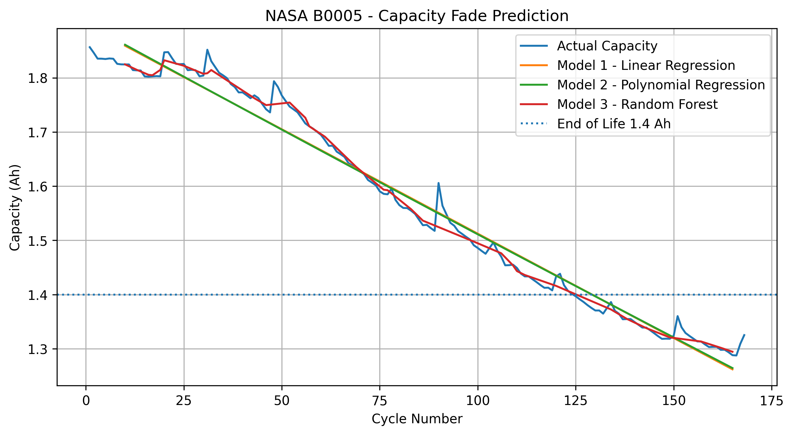

# SoH-CapFade: Capacity Fade Modelling and SoH Estimation of Li-ion Cells using NASA Dataset

## 1. Introduction
The capacity of a Lithium-ion battery decreases with every charge-discharge cycle. This gradual loss of capacity is called capacity fade. It is the main indicator of battery ageing. If this fade is not monitored, the battery can fail suddenly in electric vehicles and energy storage systems. Accurate prediction of capacity helps in planning timely replacement and improving safety.

## 2. Objective
The main objective of this project is to model the capacity fade of a Li-ion cell and to estimate its State of Health (SoH) using Machine Learning. Three regression models were developed and compared to find which model predicts the remaining capacity most accurately.

## 3. Dataset Used
The NASA Ames Prognostics Data Repository was used for this project. The B0005 battery cell was selected for the study.
- **Battery Cell:** B0005
- **Total Cycles:** 168
- **Initial Capacity:** 2.0 Ah
- **End of Life (EOL) Threshold:** 1.4 Ah
- **Input Feature:** Cycle Number
- **Target Variable:** Capacity (Ah)

## 4. Methodology Followed
First, the `B0005.mat` file was loaded and the discharge capacity for each cycle was extracted. A dataframe of Cycle vs Capacity was created. The data was then split into 80% training and 20% testing data using `shuffle=True`, so that the model could learn from all types of data. Three models were trained on the training data and tested on the unseen testing data.

Two metrics were used for evaluation:
- **RMSE:** Lower value means lower prediction error.
- **R2 Score:** Higher value, close to 1, means better prediction.

## 5. Models Implemented
**Model 1 - Linear Regression:** It fits a straight line between cycle number and capacity. It is simple but cannot capture non-linear fade.
**Model 2 - Polynomial Regression (Degree 2):** It fits a curved line to capture the non-linear trend of capacity fade.
**Model 3 - Random Forest:** It builds many decision trees and takes their average. It is able to capture the non-linear fade and sudden capacity regeneration peaks in the data.

## 6. Results

| Model | RMSE | R2 Score |
| :--- | :--- | :--- |
| Model 1 - Linear Regression | 0.0296 | 0.9761 |
| Model 2 - Polynomial Regression | 0.0295 | 0.9763 |
| Model 3 - Random Forest | 0.0104 | 0.9970 |

The results show that all three models performed well with R2 above 0.97. However, Random Forest clearly outperformed the other two models. It achieved the lowest RMSE of 0.0104 and the highest R2 score of 0.9970. Linear and Polynomial models gave almost similar results, because both fail to capture the sudden ups and downs in the capacity curve.

## 7. Conclusion
In this project, the State of Health and capacity fade of a Lithium-ion battery were successfully modelled using the NASA B0005 dataset. The capacity of the battery was observed to decrease from 2.0 Ah to around 1.4 Ah over 168 cycles, which is the end of life point. Among the three models compared, Random Forest performed the best with an R2 score of 0.9970. This proves that Machine Learning can be used to predict the remaining capacity of a battery before it fails, which is useful for electric vehicles and energy storage systems. In future work, more features like temperature and voltage can be added to further improve the prediction.